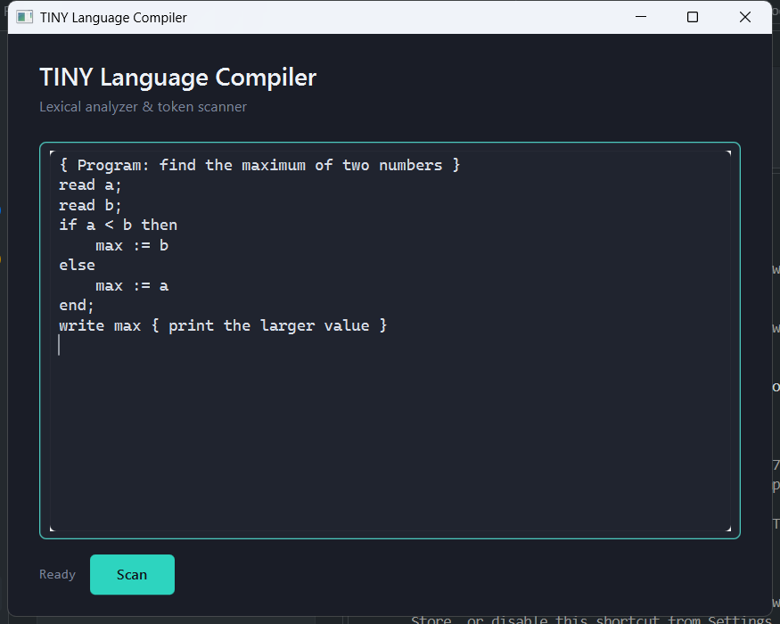
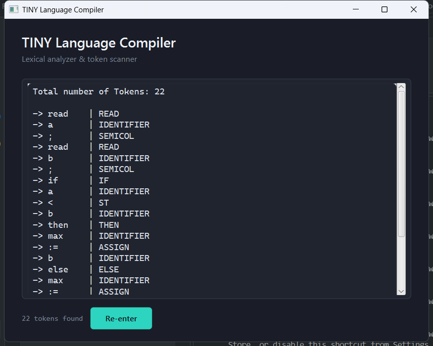

# TINY Language Compiler — Lexical Analyzer

A desktop app, built for a university **Design of Compilers** course, that performs lexical analysis on programs written in **TINY** — a small teaching language with `if/then/else`, `repeat/until`, `read`/`write`, assignment, and arithmetic/relational operators. Paste in a TINY program, press **Scan**, and the app tokenizes it, showing every lexeme next to its recognized token type.




## How it works

The scanner (`Scanner.java`) is a hand-written DFA-based lexer: it walks the input character by character through a small state machine (`States.java`: `START`, `INID`, `INNUM`, `INASSIGN`, `INCOMMENT`, `DONE`) and emits a `Token` each time it reaches an accepting state. Identifiers are checked against the TINY keyword list (`int`, `if`, `then`, `else`, `end`, `read`, `write`, `repeat`, `until`) to decide whether they're a keyword or a plain identifier; everything else maps to a fixed symbol table of operators and punctuation (`TokenType.java`).

Recognized token types: `INTEGER`, `IDENTIFIER`, `LPAREN`/`RPAREN`, `READ`/`WRITE`, `IF`/`THEN`/`ELSE`/`END`, `PLUS`/`MINUS`/`MLT`/`DIV`, `EQ`/`ST`/`GT`, `REPEAT`/`UNTIL`, `SEMICOL`, `ASSIGN`, `NUMBER`. `{ ... }` is treated as a comment and stripped out of the output.

## Tech stack

- **Java 17**
- **JavaFX 17** (`javafx-controls`, `javafx-fxml`) for the GUI
- **Maven** for build/dependency management
- FXML + CSS for the UI layout and theme (no external UI framework)

## Getting started

Prerequisites: JDK 17+ and Maven 3.6+.

```bash
git clone https://github.com/hassanxadel/Design-of-compiler.git
cd Design-of-compiler
mvn javafx:run
```

To just compile:

```bash
mvn clean compile
```

To build a runnable jar (output in `target/`):

```bash
mvn package
```

To run the scanner smoke test without launching the GUI:

```bash
mvn test-compile
java -cp target/classes:target/test-classes tiny.ScannerSmokeTest   # Windows: use ; instead of :
```

## Project structure

```
src/main/java/tiny/        Java source (Scanner, Token, TokenType, States, Tiny, FXMLDocumentController)
src/main/resources/tiny/   FXMLDocument.fxml, styles.css
src/test/java/tiny/        ScannerSmokeTest.java
Screenshots/                Screenshots of the app
pom.xml                     Maven build config
RESTORE_NOTES.md            Notes from restoring this project to a buildable/runnable state
```

## Example

Input:

```
{ Program: find the maximum of two numbers }
read a;
read b;
if a < b then
    max := b
else
    max := a
end;
write max { print the larger value }
```

Output (excerpt):

```
Total number of Tokens: 22

-> read    | READ
-> a       | IDENTIFIER
-> ;       | SEMICOL
-> read    | READ
-> b       | IDENTIFIER
-> ;       | SEMICOL
-> if      | IF
-> a       | IDENTIFIER
-> <       | ST
-> b       | IDENTIFIER
-> then    | THEN
...
```

## Known limitations

This is a lexer only — it does not parse or execute TINY programs, and it has no error reporting for malformed tokens (an invalid token, like a lone `:` or an unterminated `{` comment, is silently dropped rather than flagged). This matches the original assignment's scope.
